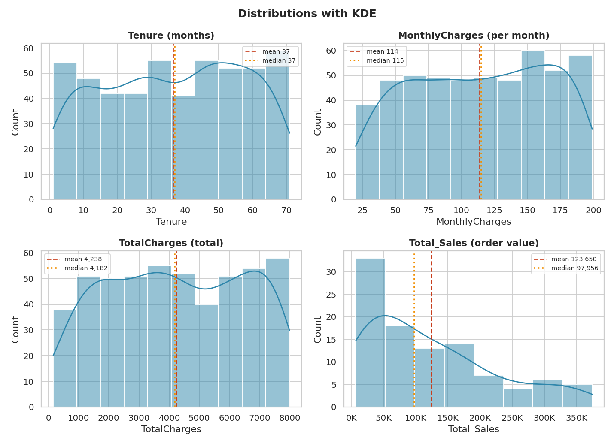
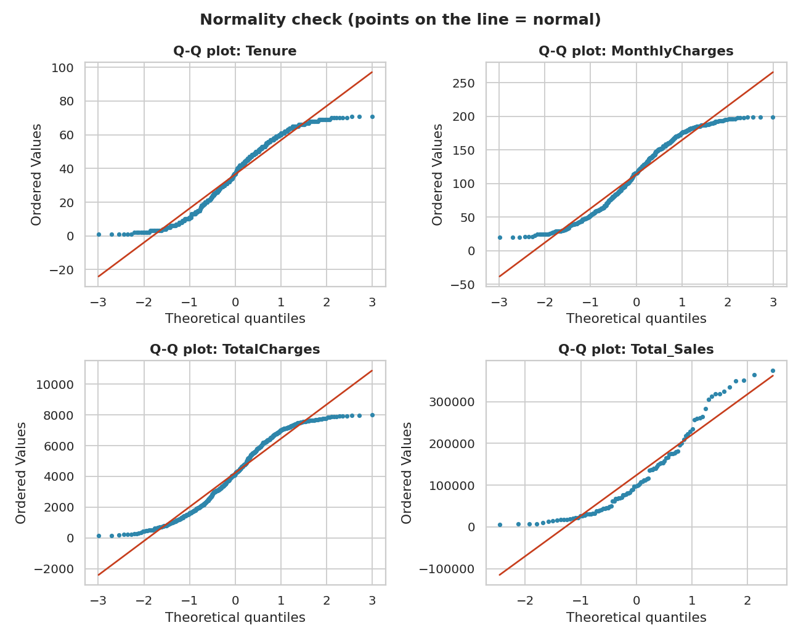
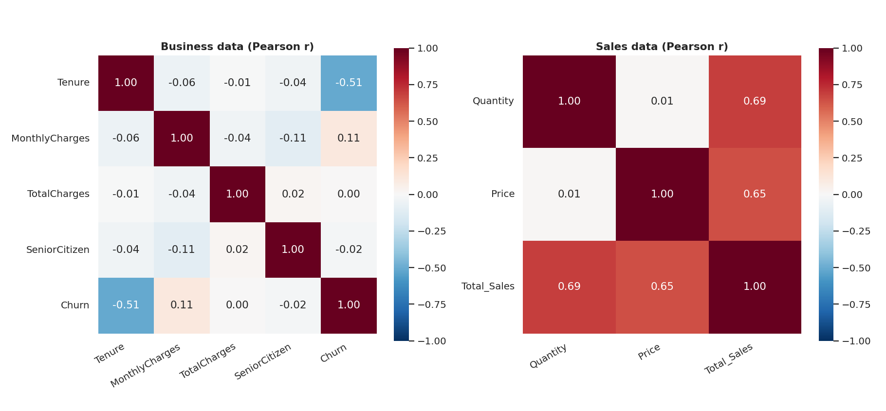
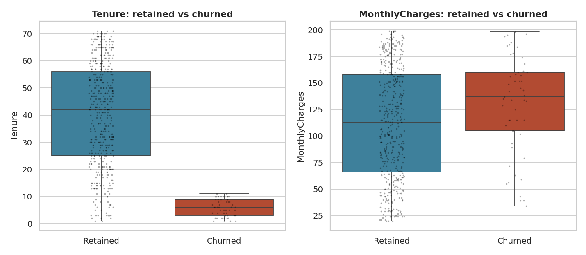
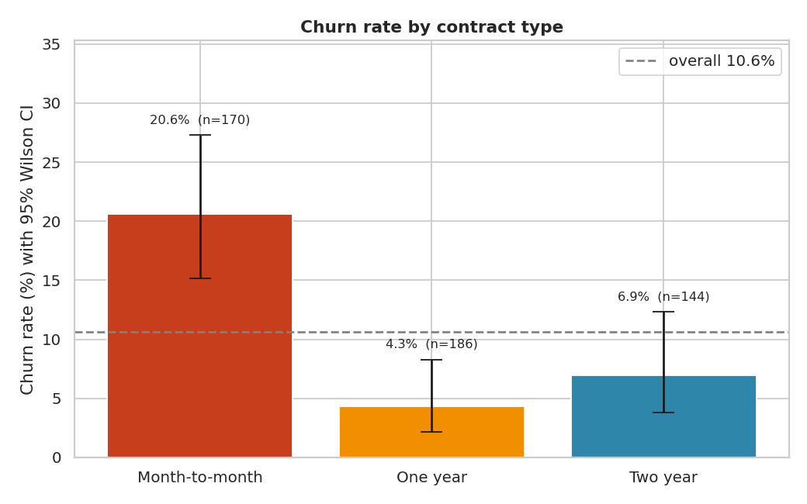
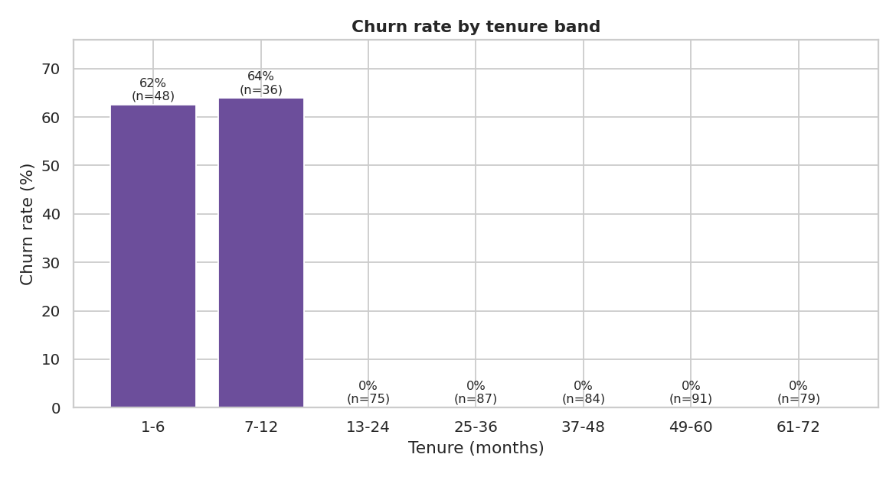
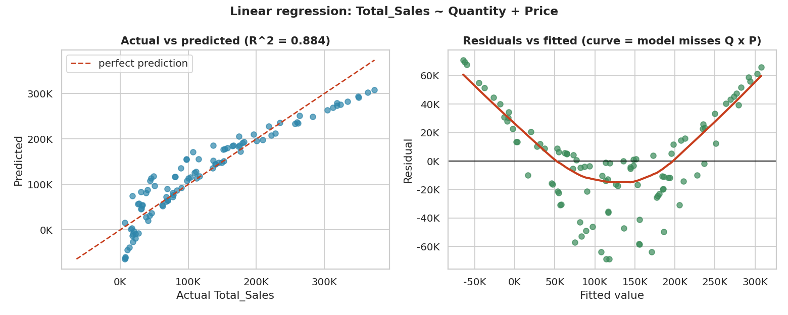
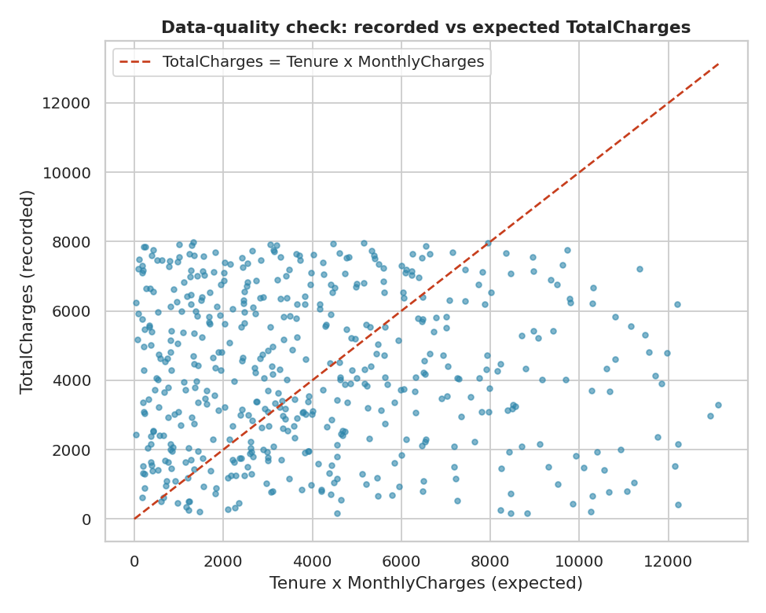
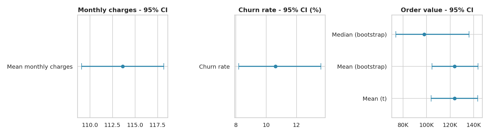
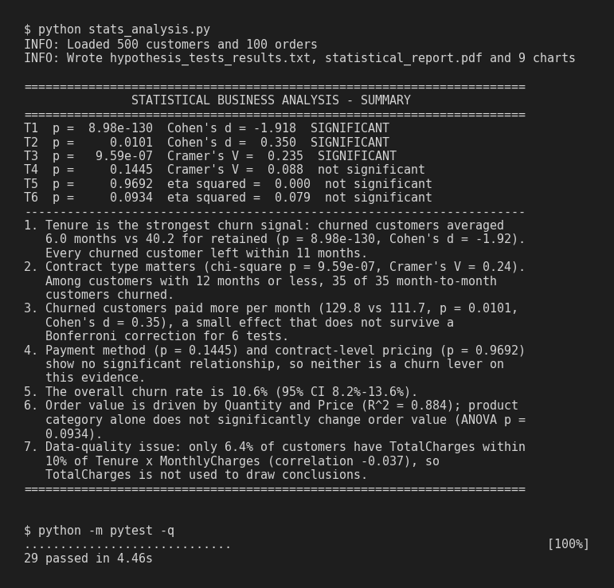

# Week 7 – Statistical Business Analysis

Applying descriptive statistics, hypothesis testing, correlation, confidence intervals and regression to business data to find **what drives customer churn and order value**, then turning the results into recommendations.

Built with Python, pandas, SciPy, statsmodels, matplotlib and seaborn.

## Project Overview

**Business questions**

1. Which customer characteristics are linked to churn?
2. Does contract type, payment method or price level affect churn?
3. What drives order value in the sales data?
4. How precise are our key metrics (average charges, churn rate, order value)?

**Data**

| File | Rows | Used for |
|---|---|---|
| `business_data.csv` | 500 customers | Tenure, MonthlyCharges, TotalCharges, Contract, PaymentMethod, PaperlessBilling, SeniorCitizen, Churn (0/1) |
| `data/sales_data.csv` | 100 orders | Product, Quantity, Price, Region, Total_Sales (Jan–Apr 2024) |

> **Scope note:** neither dataset has a marketing-spend column, so the "marketing spend vs revenue" example in the task brief cannot be tested. The same methods (correlation, hypothesis tests, regression) are applied to the relationships that exist in the data.

**Headline results**

| Finding | Evidence |
|---|---|
| Tenure is the strongest churn signal | Churned avg 6.0 months vs 40.2 retained, Welch t-test p = 8.98e-130, Cohen's d = −1.92. No customer churned after 11 months |
| Contract type is linked to churn | χ² p = 9.59e-07, Cramér's V = 0.24. Churn: month-to-month 20.6%, one-year 4.3%, two-year 6.9% |
| Churners pay slightly more per month | 129.8 vs 111.7, p = 0.0101 (small effect, d = 0.35) – **not** significant after Bonferroni correction |
| Payment method, contract pricing, product category | No significant effect (p = 0.1445, 0.9692, 0.0934) |
| Churn rate | 10.6%, 95% CI 8.2%–13.6% (Wilson) |
| Order value model | Total_Sales ~ Quantity + Price, R² = 0.884 |
| Data-quality issue | Only 6.4% of rows have TotalCharges within 10% of Tenure × MonthlyCharges |

Full results: [`hypothesis_tests_results.txt`](hypothesis_tests_results.txt) and [`statistical_report.pdf`](statistical_report.pdf).

## Project Structure

```
week7-statistical-business-analysis/
├── README.md
├── statistical_analysis.ipynb      # main notebook – step-by-step analysis with outputs
├── stats_analysis.py               # reusable functions (the notebook imports this)
├── business_data.csv               # 500-customer business dataset
├── statistical_report.pdf          # report: methodology, results, interpretation, charts
├── hypothesis_tests_results.txt    # plain-text summary of every statistical test
├── requirements.txt
├── pytest.ini
├── data/
│   └── sales_data.csv              # 100-order sales dataset
├── visualizations/                 # 9 charts (PNG) generated by the pipeline
├── screenshots/
│   └── terminal_output.png         # pipeline run + test results
└── tests/
    └── test_stats_analysis.py      # 29 pytest tests
```

## Setup Instructions

1. Install Python 3.9 or newer.
2. Clone and enter the repository:
   ```bash
   git clone https://github.com/surajsuman23/week7-statistical-business-analysis.git
   cd week7-statistical-business-analysis
   ```
3. (Optional) create a virtual environment:
   ```bash
   python -m venv venv
   source venv/bin/activate        # Windows: venv\Scripts\activate
   ```
4. Install dependencies:
   ```bash
   pip install -r requirements.txt
   ```
5. Run the analysis – either open the notebook:
   ```bash
   jupyter notebook statistical_analysis.ipynb
   ```
   or regenerate every output from the command line:
   ```bash
   python stats_analysis.py
   ```
   This writes `visualizations/`, `hypothesis_tests_results.txt` and `statistical_report.pdf`. Options: `--business`, `--sales`, `--out`.
6. Run the tests:
   ```bash
   python -m pytest -v
   ```

All paths are relative to the project folder, so it runs on any machine.

## Code Structure

`stats_analysis.py` is organised in the same order as the analysis:

| Section | Functions |
|---|---|
| Load & validate | `load_business_data()`, `load_sales_data()`, `total_charges_consistency()` |
| Descriptive stats | `descriptive_stats()`, `normality_tests()` |
| Correlation | `correlation_table()` (Pearson / Spearman with p-values) |
| Hypothesis tests | `welch_ttest()`, `chi_square_test()`, `anova_test()`, `run_hypothesis_tests()`, `bonferroni()` |
| Confidence intervals | `mean_ci()` (t), `proportion_ci()` (Wilson), `bootstrap_ci()` |
| Regression | `fit_ols()`, `regression_summary()`, `run_regressions()` |
| Visualizations | 9 plotting functions + `create_visualizations()` |
| Reporting | `business_insights()`, `format_results_text()`, `build_pdf_report()`, `run_analysis()` |

## How the Technical Requirements Are Met

| Requirement | Where |
|---|---|
| Calculate all descriptive statistics | Mean, median, mode, SD, variance, min/Q1/Q3/IQR/max, skewness, kurtosis, CV – notebook §1, PDF "Results" |
| Distribution analysis & normality | Histograms + KDE, Q-Q plots, Shapiro–Wilk and D'Agostino–Pearson – notebook §2, charts 01–02 |
| At least 3 hypothesis tests | 6 tests: 2 Welch t-tests, 2 χ² tests, 2 one-way ANOVAs, each with H0/H1, statistic, p-value, effect size, non-parametric check and plain-English conclusion – notebook §4 |
| Correlation analysis | Pearson and Spearman with p-values + heatmap – notebook §3, chart 03 |
| Confidence intervals | 95% t, Wilson and bootstrap CIs with margin of error – notebook §5, chart 09 |
| Regression analysis | 3 OLS models with R², coefficients, p-values, residual diagnostics – notebook §6, chart 07 |
| Business insights | Insights + recommendations – notebook §8, PDF section 4–5 |

## Hypothesis Test Summary (α = 0.05)

| # | Question | Test | Statistic | p-value | Effect size | Decision |
|---|---|---|---|---|---|---|
| T1 | Churned vs retained tenure | Welch t-test | t = −34.53 | 8.98e-130 | d = −1.92 (large) | Reject H0 |
| T2 | Churned vs retained monthly charges | Welch t-test | t = 2.65 | 0.0101 | d = 0.35 (small) | Reject H0 |
| T3 | Contract type × churn | χ² independence | χ² = 27.72 | 9.59e-07 | V = 0.24 | Reject H0 |
| T4 | Payment method × churn | χ² independence | χ² = 3.87 | 0.1445 | V = 0.09 | Fail to reject |
| T5 | Monthly charges by contract | One-way ANOVA | F = 0.03 | 0.9692 | η² = 0.000 | Fail to reject |
| T6 | Order value by product | One-way ANOVA | F = 2.05 | 0.0934 | η² = 0.079 | Fail to reject |

Non-parametric checks (Mann–Whitney U, Kruskal–Wallis) agree with every decision. With a Bonferroni-corrected threshold of 0.0083, only **T1 and T3** remain significant.

## Visual Documentation

| | |
|---|---|
|  |  |
|  |  |
|  |  |
|  |  |
|  |  |

## Testing Evidence

`tests/test_stats_analysis.py` – 29 tests:

- **Validation:** missing file, missing columns, empty file, invalid churn values, duplicate and non-numeric rows
- **Statistics vs SciPy:** descriptive stats, Pearson r, Welch t-test, χ², ANOVA and t-interval all match SciPy/NumPy
- **Known answers:** Cohen's d on a hand-worked example, OLS recovers y = 3x + 2 exactly, Wilson interval bounds, bootstrap reproducibility (fixed seed), normality test separates normal vs uniform data
- **End-to-end:** the pipeline writes 9 charts, a results file with 6 tests and a valid PDF

```
$ python -m pytest -q
.............................                                            [100%]
29 passed
```

## Key Insights & Recommendations

1. **Churn is a first-year problem** – all churn happened within 11 months, and among customers with ≤ 12 months' tenure, 35 of 35 month-to-month customers churned. → Focus retention on the first year (onboarding check-ins at months 1, 3 and 6).
2. **Contracts protect against churn** – month-to-month churn is about 3–5× higher than for 1- or 2-year contracts. → Offer incentives to move to a longer contract early.
3. **Price is a weak signal** – churners pay a bit more, but the effect does not survive correction for multiple tests. → Test a pricing change before rolling it out.
4. **Payment method doesn't matter** here – not a priority lever.
5. **Fix TotalCharges at source** before using it for revenue or lifetime-value work.
6. **Collect marketing-spend data** so its effect on revenue can be tested.

## Limitations

- Observational data: tests show association, not causation.
- Only 53 churned customers, so estimates for churners are less precise.
- Some patterns are unusually clean (no churn after 11 months), which suggests the dataset may be simulated – validate on real data before acting.
- The sales data covers about 3 months and 100 orders.

## What I Learned

- Choosing the right test for the data type (t-test for two means, ANOVA for several, χ² for two categories)
- Why effect size matters as much as the p-value, and why running many tests needs a correction
- Checking assumptions (normality, equal variance) and backing parametric tests with non-parametric ones
- Using bootstrap and Wilson intervals when the usual formulas are not ideal
- Reading residual plots to see when a linear model is the wrong shape
- Checking data quality before trusting a column
